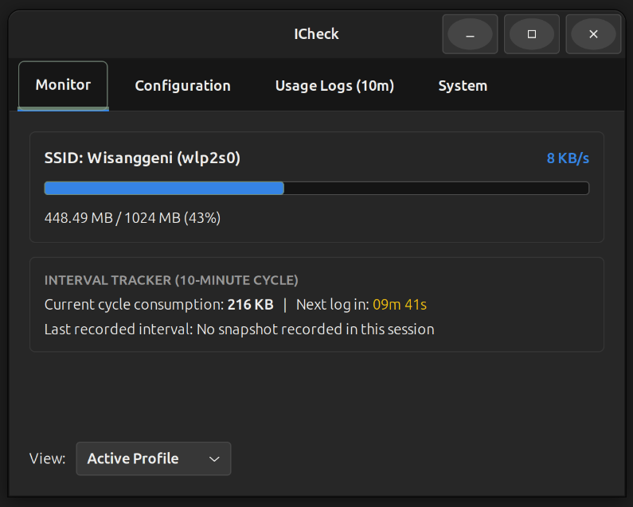
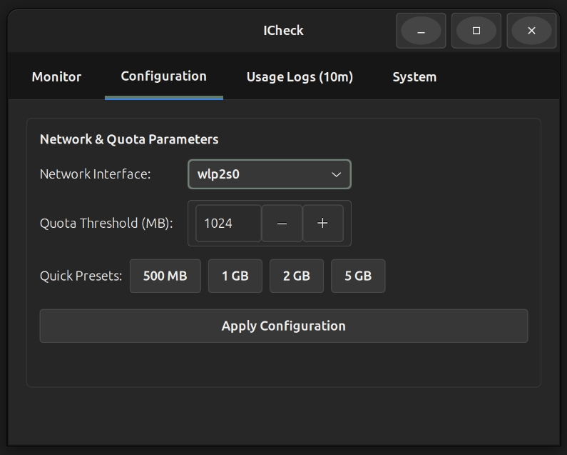
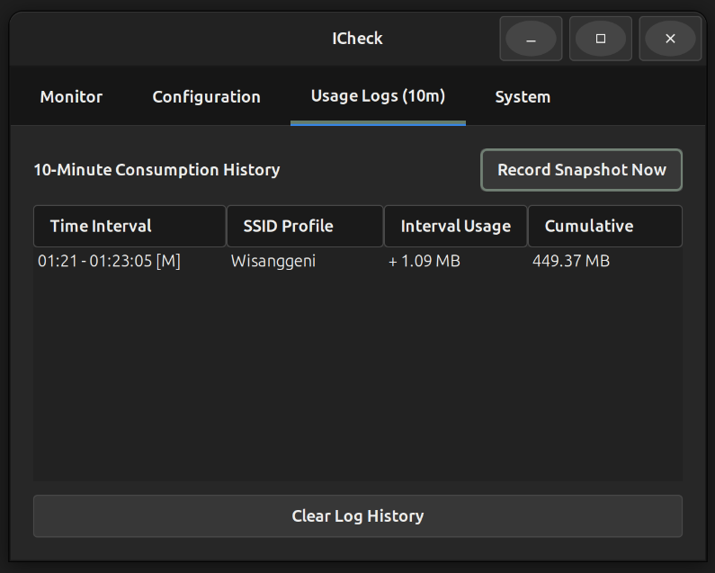
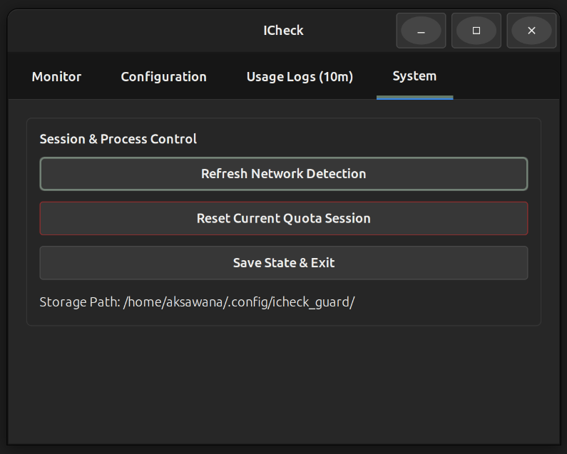

# ICheck — Network Quota & Bandwidth Monitor


**ICheck** is a lightweight, dark-themed desktop network quota monitor for Linux built with **Python 3** and **GTK+ 3 (PyGObject)**. Inspired by the clean, tabbed utility layout of `pavucontrol`, it reads kernel network interface statistics directly from `/proc/net/dev` to track real-time bandwidth rates, per-SSID data consumption, and automated 10-minute usage snapshots with minimal CPU and memory overhead.

---

## Key Features

* **Per-SSID Quota Tracking:** Automatically detects the active Wi-Fi SSID and network interface, maintaining separate data consumption profiles and quota limits for every hotspot.
* **Real-Time Bandwidth Telemetry:** Polls `/proc/net/dev` every second to calculate live RX/TX throughput (`KB/s` or `MB/s`) without relying on heavy background daemons.
* **10-Minute Interval Logger:** Tracks data consumed within a rolling 10-minute window (with a live countdown timer) and automatically commits snapshots to a persistent log table.
* **Visual Threshold Alerts:** Dynamic progress bar styling that transitions from normal (Blue) to warning at **80%** (Amber) and critical at **100%** (Red), accompanied by desktop notifications and audio alerts.
* **Crash-Safe Persistence:** Automatically saves cumulative byte counters to `~/.config/icheck_guard/` across reboots, interface changes, and SSID switches.

---

---

## Application Features & Screenshots

Berikut adalah pratinjau tampilan antarmuka dari setiap tab fitur utama pada aplikasi ICheck:

### 1. Monitor Tab
Memantau penggunaan kuota secara *real-time*, kecepatan unduh/unggah jaringan aktif, progress bar dinamis, serta siklus penghitung waktu mundur interval 10 menit.


### 2. Configuration Tab
Mengatur batas kuota harian atau bulanan secara fleksibel menggunakan *SpinButton* atau tombol *preset* cepat, serta memilih *interface* jaringan yang ingin dipantau.


### 3. Usage Logs (10m) Tab
Menyajikan tabel riwayat konsumsi data per 10 menit secara otomatis beserta fitur pencatatan manual dan pembersihan log riwayat.


### 4. System Tab
Menyediakan kontrol manajemen sesi seperti deteksi ulang jaringan, tombol *reset* kuota darurat, serta tombol keluar aplikasi yang aman.


## System Dependencies & Library Installation

ICheck relies on native Linux system utilities and GTK+ 3 bindings for Python. Before running the application, install the required libraries according to your Linux distribution:

### 1. Ubuntu / Debian / Linux Mint
```bash
sudo apt update
sudo apt install python3 python3-gi gir1.2-gtk-3.0 network-manager iproute2 libnotify-bin alsa-utils
```

### 2. Fedora / RHEL
```bash
sudo dnf install python3 python3-gobject gtk3 NetworkManager iproute libnotify alsa-utils
```

### 3. Arch Linux / Manjaro
```bash
sudo pacman -S python python-gobject gtk3 networkmanager iproute2 libnotify alsa-utils
```

> **Optional Font:** For the best visual appearance matching the stylesheet, install the **League Spartan** or **Ubuntu** font family on your system.

### Dependency Breakdown
| Package / Library | Purpose in ICheck |
| :--- | :--- |
| `python3-gi` & `gir1.2-gtk-3.0` | Renders the GTK+ 3 graphical user interface and CSS styling. |
| `network-manager` (`nmcli`) | Detects the currently connected Wi-Fi SSID name. |
| `iproute2` (`ip`) | Automatically identifies the active default network interface. |
| `libnotify-bin` (`notify-send`) | Sends critical desktop notifications when quota reaches 100%. |
| `alsa-utils` (`aplay`) | Plays system audio alerts when quota limits are exceeded. |

---

## Installation & Usage

1. **Clone the repository:**
   ```bash
   git clone [https://github.com/YOUR_USERNAME/icheck-network-monitor.git](https://github.com/YOUR_USERNAME/icheck-network-monitor.git)
   cd icheck-network-monitor
   ```

2. **Grant execution permissions:**
   ```bash
   chmod +x icheck.py
   ```

3. **Run the application:**
   ```bash
   ./icheck.py
   # or
   python3 icheck.py
   ```

---

## Application Structure

* **Monitor Tab:** Displays active SSID, network interface, real-time transfer rate, visual quota progress bar, and the live 10-minute cycle tracker.
* **Configuration Tab:** Allows switching the monitored network interface (`wlp2s0`, `wlan0`, `eth0`, etc.) and configuring custom MB/GB quota limits with quick-select presets.
* **Usage Logs (10m) Tab:** Presents a historical table of 10-minute consumption intervals (`Time Interval`, `SSID Profile`, `Interval Usage`, and `Cumulative Usage`), with support for manual snapshot triggers.
* **System Tab:** Provides session management controls to refresh network detection, reset active quota counters to `0 KB`, or safely save state and exit.

---

## Configuration & Data Storage

All configuration files and historical logs are stored locally in plain text inside `~/.config/icheck_guard/`:

* `iface.txt` — Stores the user-selected network interface.
* `limit_<SSID>.txt` — Stores the configured quota threshold (in MB) for a specific SSID.
* `base_bytes_<SSID>.txt` & `accum_<SSID>.txt` — Tracks session byte offsets and cumulative usage.
* `log10m_<SSID>.txt` — Pipe-delimited (`|`) historical records of 10-minute usage snapshots.

---

## License

This project is open-source and available under the [MIT License](LICENSE).
